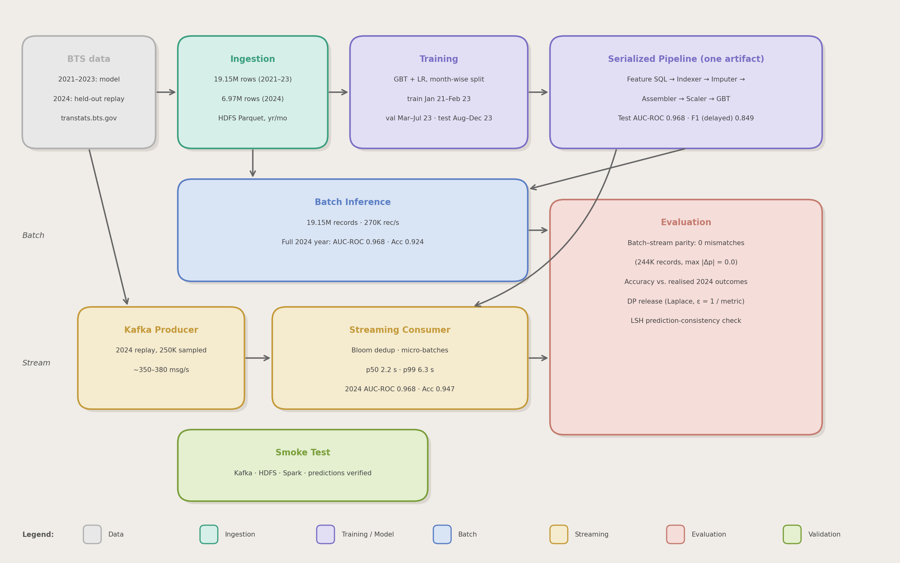

# Real-Time Flight Delay Predictor

**SJSU DATA-228 — Big Data Technologies · Spring 2026**

An end-to-end big data pipeline that ingests 19.15M BTS flight records (2021–2023) into HDFS, trains Gradient Boosted Tree and Logistic Regression classifiers with Spark MLlib on a chronological split, replays a held-out year (2024) through Apache Kafka, scores it with Spark Structured Streaming using the same serialized model as batch inference, and evaluates streaming accuracy, batch/streaming parity and end-to-end latency — with Differential Privacy, LSH consistency checks, Bloom Filter deduplication, Reservoir Sampling, and SHAP explainability.

---

## Team

| Name | Role |
|------|------|
| Anees Saheba Guddi | Evaluation & Reporting — benchmark design, DP, LSH, visualizations, final report |
| Kartheek Alluri | Data & Infrastructure — BTS acquisition, HDFS setup, batch inference |
| Keon Sadeghi | Streaming & Kafka — producer, consumer, Bloom filter |
| Manjot Kaur | ML Engineering — EDA, feature engineering, model training, SHAP |
| Rish Jain | Integration & DevOps — Docker Compose, orchestration, smoke tests |

---

## Architecture



```
┌─────────────────────────────────────────────────────────────────────────────┐
│  BTS On-Time Performance CSVs                                               │
│  2021–2023: 19,153,634 flights (train/val/test)  ·  2024: 6,965,247 (hold-out)│
└────────────────────────────────┬────────────────────────────────────────────┘
                                 ▼
┌─────────────────────────────────────────────────────────────────────────────┐
│  INGESTION   ingest_bts_to_hdfs.py                                          │
│  · Normalize column names     · Drop flights with no ARR_DELAY              │
│  · Cast types                 · Binary label (ARR_DELAY > 15 min)           │
│  · Snappy Parquet → HDFS, partitioned by YEAR / MONTH                       │
└────────────────────────────────┬────────────────────────────────────────────┘
                                 ▼
┌─────────────────────────────────────────────────────────────────────────────┐
│  TRAINING   train_chronological.py                                          │
│  Split by calendar month: train Jan 2021–Feb 2023 · val Mar–Jul 2023 ·      │
│                           test Aug–Dec 2023                                 │
│  One PipelineModel per classifier:                                          │
│  SQLTransformer (feature derivation) → StringIndexer → Imputer →            │
│  VectorAssembler → StandardScaler → GBT / LR                                │
│  · Hyperparameters chosen on validation AUC-ROC                             │
│  · Decision threshold chosen on validation positive-class F1                │
│  · Class weights from the training months only · SHAP on the test months    │
└──────────┬──────────────────────────────────────┬───────────────────────────┘
           ▼                                      ▼
┌──────────────────────────┐    ┌─────────────────────────────────────────────┐
│  BATCH INFERENCE         │    │  STREAMING                                  │
│  batch_inference.py      │    │  kafka_producer.py                          │
│  · Same PipelineModel    │    │  · Reservoir sample of 2024 (Algorithm R)   │
│  · 269.6K records/s on   │    │  · JSON → Kafka, producer_ts set at send    │
│    19.15M rows           │    │  Kafka (KRaft · 4 partitions)               │
│  · Full 2024 hold-out    │    │  streaming_consumer.py                      │
│                          │    │  · Warm-up · Bloom-filter dedup             │
│                          │    │  · model.transform() → Parquet on HDFS      │
│                          │    │  · Per-batch write-completion log           │
└──────────┬───────────────┘    └──────────────┬──────────────────────────────┘
           └───────────────────┬───────────────┘
                               ▼
┌─────────────────────────────────────────────────────────────────────────────┐
│  EVALUATION                                                                 │
│  evaluate_streaming.py — streamed accuracy, batch/streaming parity, latency │
│  cost_analysis.py · dp_repeat.py · lsh_consistency.py · benchmark.py        │
└─────────────────────────────────────────────────────────────────────────────┘
```

---

## Results

All numbers below come from the JSON files in [logs/](logs/); the file is named under each table.

### Model performance — test months Aug–Dec 2023 (2,878,386 flights)

| Metric | GBT @0.5 | GBT @0.77 (val-selected) | LR @0.5 | LR @0.74 (val-selected) | DEP_DELAY > 15 rule |
|---|:---:|:---:|:---:|:---:|:---:|
| AUC-ROC | **0.9684** | **0.9684** | 0.9642 | 0.9642 | — |
| AUC-PR | **0.9233** | **0.9233** | 0.9159 | 0.9159 | — |
| Accuracy | 0.9294 | **0.9516** | 0.9232 | 0.9486 | 0.9280 |
| Weighted F1 | 0.9321 | **0.9511** | 0.9267 | 0.9484 | 0.9283 |
| Delayed-class precision | 0.7341 | **0.8718** | 0.7106 | 0.8504 | 0.7753 |
| Delayed-class recall | 0.8943 | 0.8274 | **0.8991** | 0.8339 | 0.7913 |
| Delayed-class F1 | 0.8064 | **0.8490** | 0.7938 | 0.8421 | 0.7832 |

<sub>logs/train_chronological_full_corpus.json</sub>

- **Selected hyperparameters:** GBT maxDepth = 8, maxIter = 100 (val AUC 0.9677); LR regParam = 0.0 (val AUC 0.9620).
- **Class weights (training months):** on-time 0.615 · delayed 2.679.
- **SHAP (mean |SHAP|, log-odds, 2,000 test rows):** DEP_DELAY 1.14 · TAXI_OUT 0.29 · DISTANCE 0.24 · CRS_ELAPSED_TIME 0.15 · DEP_DEL15 0.13; everything else < 0.07.
- **Trivial baseline:** predicting "delayed" whenever departure delay > 15 min already reaches 0.928 accuracy, so the delayed-class metrics are the ones to compare.

### Pre-departure ablation (DEP_DELAY, DEP_DEL15 and TAXI_OUT removed)

| | GBT | LR |
|---|:---:|:---:|
| AUC-ROC | 0.6347 (−0.334) | 0.6096 (−0.355) |
| Weighted F1 @0.5 | 0.6665 | 0.3831 |
| Delayed-class F1 @val threshold | 0.3271 | 0.3172 |

The full model is a post-departure predictor: almost all of its skill comes from the departure delay.

### Cost-sensitive comparison

With r = c_FN / c_FP (cost of a missed delay ÷ cost of a false alarm):

| r | Cheapest operating point |
|---|---|
| ≤ 3.02 | GBT @0.77 |
| 3.02 – 8.78 | GBT @0.5 |
| > 8.78 | LR @0.5 |

GBT @0.77 has fewer false negatives **and** fewer false positives than the DEP_DELAY rule, so it is cheaper at every r. <sub>logs/cost_analysis_chronological.json</sub>

### Streaming on the 2024 hold-out

250,000 flights reservoir-sampled from 2024 (seed 42) are replayed through Kafka at a 500 msg/s target (about 350–380 msg/s achieved). The consumer loads the GBT PipelineModel above.

| | Value |
|---|---|
| Flights scored / with a known outcome | 248,451 / 244,448 |
| AUC-ROC · AUC-PR | 0.9681 · 0.9358 |
| Accuracy @0.77 | 0.9472 |
| Delayed-class F1 @0.77 | 0.8656 |
| Batch/streaming parity | max \|Δp\| = 0.0, 0 prediction mismatches |
| Bloom filter | 250,000 keys seen, 1,549 dropped (≈0.6%, false positives) |

**End-to-end latency** is measured from Kafka publish (`producer_ts`, set at send) to the moment the micro-batch holding the record finishes writing its predictions to HDFS:

| Trigger | p50 | p90 | p95 | p99 | max |
|---|---:|---:|---:|---:|---:|
| 0 s (back-to-back) | 2,229 ms | 3,508 ms | 4,087 ms | 6,319 ms | 11,110 ms |
| 1 s | 2,270 ms | 3,662 ms | 4,379 ms | 8,493 ms | 11,665 ms |
| 10 s | 11,655 ms | 32,308 ms | 41,959 ms | 54,802 ms | 60,896 ms |

With the 0 s trigger, 70% of the events above p99 fall in the first three micro-batches (cluster start-up), and the median batch takes about 1.0 s from start to write completion. <sub>logs/streaming_eval_2024_trigger{0s,1s,10s}.json</sub>

### Batch inference

| Data | Records | Throughput | AUC-ROC | Accuracy @0.5 |
|---|---:|---:|:---:|:---:|
| 2021–2023 (incl. training months) | 19,153,634 | **269,594 rec/s** | 0.9688 | 0.9291 |
| 2024 hold-out (full year) | 6,965,247 | 180,782 rec/s | 0.9683 | 0.9241 |

<sub>logs/batch_chrono_gbt_2021_2023_throughput.json, logs/batch_chrono_gbt_2024_holdout.json</sub>

### Privacy, similarity and sampling

| Technique | Library | Result |
|---|---|---|
| Differential Privacy (Laplace, ε = 1 per metric, sensitivity 0.01) | diffprivlib | 8 test metrics released 1,000 times: mean deviation ≈ 0.010 per metric; the largest deviation in a release has median 0.025 and p95 0.049. Total ε = 8 under sequential composition. <sub>logs/dp_repeat_chronological.json</sub> |
| LSH consistency (MinHashLSH, 128 perms, Jaccard ≥ 0.5) | datasketch | On 5,000 streamed predictions, random pairs disagree 36.2% of the time. Same-route pairs disagree 34.3% (≈ random), and pairs with the same route **and** departure-delay band disagree 8.7%. <sub>logs/lsh_consistency_2024.json</sub> |
| Bloom filter deduplication | pybloom-live | Scalable filter on (date, carrier, origin, dest, scheduled departure); duplicates dropped within and across micro-batches |
| Reservoir Sampling (Algorithm R) | custom | Single pass over 7,079,061 rows of 2024 CSV, O(k) memory |
| SHAP explainability | shap | TreeExplainer on the GBT, feature names in VectorAssembler order |

---

## ML Pipeline Detail

```
Raw event columns (BTS fields as ingested / as sent by the producer)
        │
        ├─ SQLTransformer   →  DEP_DEL15, dep_hour, arr_sched_hour,
        │                      is_weekend, is_holiday_season, route
        ├─ StringIndexer    →  OP_UNIQUE_CARRIER_idx, ORIGIN_idx, DEST_idx, route_idx
        ├─ Imputer (median) →  *_imp for the 13 numeric features
        ├─ VectorAssembler  →  raw_features
        ├─ StandardScaler   →  features
        └─ GBTClassifier / LogisticRegression
               └─ prediction · probability · rawPrediction

Label:      ARR_DELAY > 15 min → 1 (delayed), else 0 (on-time)
Split:      by calendar month — train 2021-01..2023-02 (13,430,175)
                                val   2023-03..2023-07 (2,845,073)
                                test  2023-08..2023-12 (2,878,386)
Selection:  hyperparameters on val AUC-ROC; threshold on val delayed-class F1
GBT grid:   maxDepth ∈ {6, 8} · maxIter ∈ {50, 100}
LR grid:    regParam ∈ {0.0, 0.001, 0.01}
```

Feature derivation lives inside the saved model (the SQLTransformer stage), so the batch job and the streaming consumer pass raw columns to `model.transform()` and cannot drift apart.

---

## Infrastructure

### Docker Compose (7 services)

| Service | Image | Ports | Role |
|---------|-------|-------|------|
| `kafka` | apache/kafka:3.7.0 | 9092, 9093 | KRaft broker + controller (no Zookeeper) |
| `kafka-init` | apache/kafka:3.7.0 | — | One-shot: creates `flight-events` topic (4 partitions) |
| `hdfs-namenode` | bde2020/hadoop-namenode:2.0.0-hadoop3.2.1-java8 | 9870, 9000 | HDFS namenode + web UI |
| `hdfs-datanode` | bde2020/hadoop-datanode:2.0.0-hadoop3.2.1-java8 | 9864 | HDFS datanode |
| `spark-master` | apache/spark:3.5.0 | 8080, 7077 | Spark standalone master |
| `spark-worker-1` | apache/spark:3.5.0 | 8081 | 4 cores · 4 GB RAM |
| `spark-worker-2` | apache/spark:3.5.0 | 8082 | 4 cores · 4 GB RAM |

All services run on the `flight-net` bridge network with healthchecks and `depends_on` ordering.

### Web UIs

| UI | URL |
|----|-----|
| Spark Master | http://localhost:8080 |
| HDFS Namenode | http://localhost:9870 |
| Spark Worker 1 | http://localhost:8081 |
| Spark Worker 2 | http://localhost:8082 |

---

## Stack

| Component | Technology | Version |
|-----------|------------|---------|
| Distributed Storage | Apache HDFS | Hadoop 3.2.1 |
| Distributed Processing | Apache Spark (PySpark) | 3.5.0 |
| Message Broker | Apache Kafka (KRaft) | 3.7.0 |
| Stream Processing | Spark Structured Streaming | 3.5.0 |
| ML | Spark MLlib — GBT + LR | 3.5.0 |
| Differential Privacy | diffprivlib | 0.5.0 |
| LSH | datasketch MinHashLSH | 1.6.4 |
| Bloom Filter | pybloom-live | 4.0.0 |
| Explainability | SHAP TreeExplainer | 0.44.1 |
| Containerization | Docker Compose | — |
| Dataset | BTS Airline On-Time Performance | 2021–2024 |

---

## Dataset

**Bureau of Transportation Statistics — Airline On-Time Performance**
Download: https://www.transtats.bts.gov/DL_SelectFields.aspx

| Data | Period | Flights | Purpose |
|------|--------|--------:|---------|
| Train | Jan 2021 – Feb 2023 | 13,430,175 | Model fitting |
| Validation | Mar – Jul 2023 | 2,845,073 | Hyperparameter and threshold selection |
| Test | Aug – Dec 2023 | 2,878,386 | Reported model metrics |
| Hold-out | Jan – Dec 2024 | 6,965,247 | Batch inference + Kafka replay |

- **Label:** `ARR_DELAY > 15 minutes → 1 (delayed), else 0 (on-time)`; flights without an ARR_DELAY (cancelled / diverted) are dropped.
- **Class balance (2021–2023):** 80.97% on-time · 19.03% delayed (16.56% in 2021, 20.37% in 2022, 19.87% in 2023).
- **Full-corpus EDA** ([plots/full_corpus/](plots/full_corpus/), logs/eda_full_corpus.json): `DEP_DELAY` is the strongest predictor (r = 0.51 with the label), followed by `TAXI_OUT` (0.23). June/July are the peak delay months (24.3% / 25.0%). JetBlue (29.6%) and Allegiant (28.8%) have the highest delay rates and Endeavor (12.2%) and Delta (14.3%) among the lowest.

---

## Quick Start

### Full cluster (Docker)

```bash
docker compose up -d                 # start all 7 services
bash scripts/setup_hdfs.sh           # create HDFS directories
```

The commands below are the ones used to produce the results above. Run the `spark-submit` commands inside the `spark-master` container (`docker exec -it spark-master bash`, repo mounted at `/opt/spark-apps`), adding `--master spark://spark-master:7077 --conf spark.hadoop.dfs.client.use.datanode.hostname=true`. Run the producer on the host.

**1 — Ingest BTS data to HDFS**
```bash
spark-submit src/ingestion/ingest_bts_to_hdfs.py \
  --input-path /opt/spark-apps/data/raw \
  --hdfs-path hdfs://hdfs-namenode:9000/full_corpus_v2/data/flights          # 2021–2023 (default --years)
spark-submit src/ingestion/ingest_bts_to_hdfs.py \
  --input-path /opt/spark-apps/data/raw_2024 --years 2024 \
  --hdfs-path hdfs://hdfs-namenode:9000/holdout_2024/data/flights
```

**2 — Train (chronological split, about 5.5 h on the 2-worker cluster)**
```bash
spark-submit src/training/train_chronological.py \
  --model-root hdfs://hdfs-namenode:9000/models_chrono \
  --metrics-json /tmp/train_chronological_full_corpus.json
```
This saves `/models_chrono/{full,pre_departure}/{gbt,lr}_pipeline` and writes test metrics, the validation-selected thresholds, the DEP_DELAY-rule baseline and SHAP rankings to the JSON. Add `--sample-fraction 0.02` for a quick smoke run.

**3 — Batch inference**
```bash
spark-submit src/batch/batch_inference.py \
  --data-path hdfs://hdfs-namenode:9000/holdout_2024/data/flights \
  --model-path hdfs://hdfs-namenode:9000/models_chrono/full/gbt_pipeline \
  --output-path hdfs://hdfs-namenode:9000/output/batch_chrono_2024 \
  --test-years 2024 --metrics-json /tmp/batch_2024.json
```

**4 — Streaming consumer**
```bash
spark-submit --packages org.apache.spark:spark-sql-kafka-0-10_2.12:3.5.0 \
  src/streaming/streaming_consumer.py \
  --kafka-bootstrap kafka:9092 \
  --model-path hdfs://hdfs-namenode:9000/models_chrono/full/gbt_pipeline \
  --output-path hdfs://hdfs-namenode:9000/output/streaming_2024_t0 \
  --checkpoint-path hdfs://hdfs-namenode:9000/checkpoints/streaming_2024_t0 \
  --batch-log /tmp/streaming_batches_2024_t0.jsonl \
  --trigger-interval "0 seconds" --await-termination 1800
```

**5 — Kafka producer (host, once the consumer reports "Streaming query started")**
```bash
python src/streaming/kafka_producer.py \
  --input-path data/raw_2024 --kafka-bootstrap localhost:9093 \
  --rate 500 --sample-size 250000 --seed 42
```

**6 — Evaluate the streaming run**
```bash
spark-submit src/evaluation/evaluate_streaming.py \
  --predictions hdfs://hdfs-namenode:9000/output/streaming_2024_t0 \
  --batch-log /tmp/streaming_batches_2024_t0.jsonl \
  --model-path hdfs://hdfs-namenode:9000/models_chrono/full/gbt_pipeline \
  --threshold 0.77 --output /tmp/streaming_eval_2024.json
spark-submit src/evaluation/lsh_consistency.py \
  --predictions hdfs://hdfs-namenode:9000/output/streaming_2024_t0 \
  --output /tmp/lsh_consistency_2024.json
```

**7 — Cost and DP analysis (host, from the training JSON)**
```bash
python src/evaluation/cost_analysis.py \
  --metrics-json logs/train_chronological_full_corpus.json \
  --output logs/cost_analysis_chronological.json
python src/evaluation/dp_repeat.py \
  --metrics-json logs/train_chronological_full_corpus.json \
  --model full/gbt/at_val_threshold --draws 1000 \
  --output logs/dp_repeat_chronological.json
```

**8 — EDA on the full corpus**
```bash
spark-submit src/training/eda_full_corpus.py --output /tmp/eda_full_corpus.json
python src/training/plot_eda_full_corpus.py \
  --input logs/eda_full_corpus.json --output plots/full_corpus
```

**Smoke test:** `python scripts/smoke_test.py`

### Earlier version of the pipeline

`train_model.py`, `train_local.py`, `eda_analysis.py`, `scripts/run_pipeline.sh` and the figures directly under `plots/` belong to the first version of the project, which used a random 70/15/15 split with 3-fold cross-validation. They are kept for reference only. The results above come from the chronological pipeline.

---

## Repository Structure

```
realtime-flight-delay-predictor/
├── docker-compose.yml
├── architecture.png                     ← pipeline diagram (generate_architecture.py)
├── data/                                ← BTS CSV files (not committed)
├── logs/                                ← JSON results of every run reported above
├── plots/
│   └── full_corpus/                     ← EDA figures from the full 2021–2023 corpus
├── scripts/
│   ├── setup_hdfs.sh                    ← HDFS directory creation
│   ├── run_pipeline.sh                  ← original end-to-end orchestration
│   ├── run_feature_pipeline.sh
│   └── smoke_test.py                    ← health checks
└── src/
    ├── ingestion/
    │   └── ingest_bts_to_hdfs.py        ← CSV → HDFS Parquet
    ├── training/
    │   ├── train_chronological.py       ← chronological split, val-based selection, SHAP
    │   ├── train_pre_departure_comparison.py ← shared preprocessing stages
    │   ├── eda_full_corpus.py           ← Spark EDA aggregates on the full corpus
    │   ├── plot_eda_full_corpus.py      ← figures from those aggregates
    │   ├── prepare_features.py
    │   ├── train_model.py · train_local.py · eda_analysis.py · eda_report.py
    │   └── generate_sample_data.py      ← synthetic data generator
    ├── streaming/
    │   ├── kafka_producer.py            ← Kafka producer + Reservoir Sampling
    │   └── streaming_consumer.py        ← Structured Streaming + Bloom filter + batch log
    ├── batch/
    │   └── batch_inference.py           ← batch scoring + throughput
    └── evaluation/
        ├── evaluate_streaming.py        ← streamed accuracy, parity, latency
        ├── cost_analysis.py             ← cost-sensitive operating-point comparison
        ├── dp_repeat.py                 ← repeated DP release
        ├── lsh_consistency.py           ← LSH consistency with random-pair baseline
        └── benchmark.py                 ← DP / LSH helpers + batch vs streaming report
```

---

## Key Design Decisions

**One serialized model for batch and streaming**
Each classifier is saved as a complete `PipelineModel`, including the SQLTransformer that derives the features. The batch job and the streaming consumer load the same object and call `transform()` on raw columns. On the 2024 replay this gives identical probabilities in both modes (max |Δp| = 0.0).

**Chronological split**
Training, validation and test cover consecutive calendar months, and 2024 is a separate hold-out. No future flight informs a model scored on the past, and class weights come from the training months only.

**Latency measured to the HDFS write**
The producer sets `producer_ts` immediately before sending, and the consumer logs when each micro-batch finishes writing. End-to-end latency is therefore publish → prediction stored, not publish → batch start.

**YEAR/MONTH partitioning**
HDFS Parquet is partitioned by YEAR and MONTH, so year filters are resolved by partition pruning.

**KRaft-mode Kafka**
Runs without Zookeeper, so the stack needs one service fewer and has one less point of failure.

**Class weighting**
About 19% of flights are delayed. Without weights, a model that always predicts "on-time" reaches 81% accuracy, so inverse-frequency weights are used to penalize missed delays.
